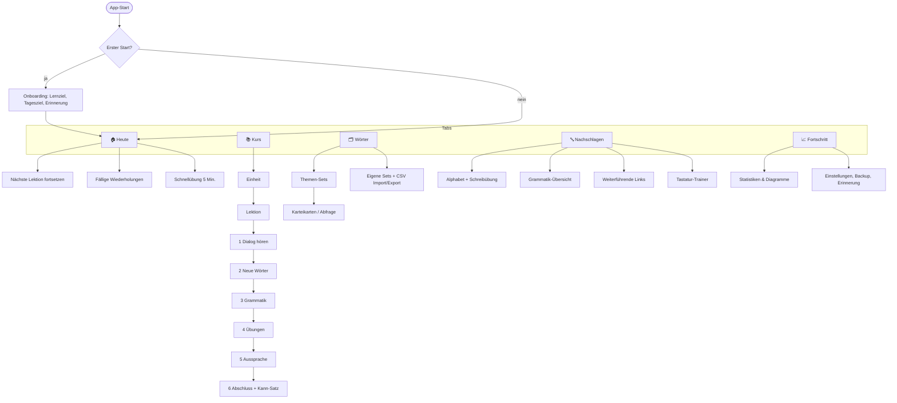

# 2. Navigation & Wireframes

## Navigationsstruktur

Fünf Tabs in einer unteren Tab-Leiste (iPhone) bzw. Seitenleiste (Desktop/iPad).



| Tab | Zweck | Inhalte |
|---|---|---|
| **Heute** | Ein Tipp – sofort lernen | Tagesziel-Ring, Streak, „Weiterlernen“, fällige Karten, Schnellübung |
| **Kurs** | Geführter Lernpfad A1 → A2 | Alphabet-Einstieg, 16 Einheiten à 5 Lektionen, Checkpoints |
| **Wörter** | Vokabeltrainer | Themen-Sets, eigene Sets, Abfrage, CSV Import/Export, Suche |
| **Nachschlagen** | Referenz | Alphabet, Grammatik-Tabellen, Tastatur-Trainer, Links |
| **Fortschritt** | Statistik & Einstellungen | Lernzeit, Vokabelzahl, Genauigkeit, Kalender-Heatmap, Backup |

Prinzip: **Maximal 2 Taps bis zum Lernen.** „Heute“ ist immer der Startpunkt.

---

## Wireframes

### 2.1 Heute (Startbildschirm)

```
┌─────────────────────────────────┐
│  Доброе утро, Thomas!     🔥 12 │  ← Streak (Tage)
│                                 │
│        ╭───────────╮            │
│       │   8 / 15   │            │  ← Tagesziel in Minuten
│       │   Minuten   │           │
│        ╰───────────╯            │
│                                 │
│ ┌─────────────────────────────┐ │
│ │ ▶ Weiterlernen              │ │
│ │ Einheit 1 · Lektion 3       │ │
│ │ „Кто это?“  ▓▓▓▓░░ 60 %     │ │
│ └─────────────────────────────┘ │
│ ┌─────────────────────────────┐ │
│ │ 🗂 Wiederholen      24 fällig│ │
│ │ ca. 6 Minuten               │ │
│ └─────────────────────────────┘ │
│ ┌──────────────┐┌─────────────┐ │
│ │ 🎧 Hören     ││ 🎙 Sprechen │ │  ← Schnellübungen
│ │ 5 Min.       ││ 5 Min.      │ │
│ └──────────────┘└─────────────┘ │
│                                 │
│ Wort des Tages: спаси́бо – danke │
├─────────────────────────────────┤
│ 🏠Heute 📚Kurs 🗂Wörter 🔤 📈    │
└─────────────────────────────────┘
```

### 2.2 Kurs (Lernpfad)

```
┌─────────────────────────────────┐
│  Kurs                    A1 ▾   │  ← Umschalten A1/A2
│                                 │
│  ✅ 0  Alphabet          4/4    │
│  ─────────────────────────────  │
│  ▼ 1  Знакомство · Kennenlernen │
│     ✅ 1.1 Приве́т!              │
│     ✅ 1.2 Как тебя́ зову́т?      │
│     ◐  1.3 Кто э́то?    ← jetzt │
│     ○  1.4 Отку́да вы?           │
│     ○  1.5 Вы говори́те по-ру́сски?│
│     🏁 Checkpoint 1             │
│  ─────────────────────────────  │
│  ▶ 2  Семья́ · Familie    0/5    │
│  ▶ 3  Чи́сла и вре́мя      0/5    │
│  🔒 …                            │  ← nur „empfohlen gesperrt“,
│                                 │     antippen öffnet trotzdem
├─────────────────────────────────┤
│ 🏠  📚Kurs  🗂  🔤  📈           │
└─────────────────────────────────┘
```

Keine harten Sperren: Erwachsene dürfen springen. Gesperrte Lektionen zeigen nur einen Hinweis „Empfohlen: erst Einheit 1“.

### 2.3 Lektion – Schritt „Dialog“ (Audio-Lektion)

```
┌─────────────────────────────────┐
│ ✕   1.3 Кто э́то?   ●●○○○○  2/6  │  ← Schritt-Fortschritt
│                                 │
│  👩 О́ля                          │
│  ┌───────────────────────────┐  │
│  │ Макс, кто э́то?        🔊 │  │  ← Satz antippen = abspielen
│  │ [maks, kto éta]           │  │  ← Lautschrift (blendet aus)
│  │ Max, wer ist das?    ⓘ    │  │  ← Übersetzung ein/aus
│  └───────────────────────────┘  │     ⓘ = Erklärung
│  👨 Макс                         │
│  ┌───────────────────────────┐  │
│  │▶Э́то Том. Он мой друг. 🔊 │  │  ← aktueller Satz hervorgehoben
│  │ ……………… (tippen zeigt DE)  │  │
│  └───────────────────────────┘  │
│                                 │
│ ┌ ⓘ Erklärung ────────────────┐ │
│ │ „Это“ = das ist / das sind. │ │
│ │ Im Präsens fehlt „sein“.    │ │
│ └─────────────────────────────┘ │
│                                 │
│  ⏮ 5s   ◀◀   ▶❚❚   ▶▶   🔁 1×  │  ← Player
│  ▓▓▓▓▓▓▓░░░░░░░  0:21 / 0:48    │
│  Tempo: 0.75× │1×│  DE ☑ Laut ☐ │
├─────────────────────────────────┤
│          [ Weiter → ]           │
└─────────────────────────────────┘
```

Player-Funktionen: Satz zurück/vor (◀◀ ▶▶), 5 s zurückspulen, Pause, Satz wiederholen (🔁, auch Endlosschleife), Tempo 0,5×/0,75×/1×, Shadowing-Modus (Pause nach jedem Satz zum Nachsprechen).

### 2.4 Karteikarte / Abfrage

```
┌─────────────────────────────────┐
│ ✕  Wiederholung        7 / 24   │
│                                 │
│ ┌─────────────────────────────┐ │
│ │                             │ │
│ │        спаси́бо         🔊   │ │
│ │                             │ │
│ │      ─ ─ ─ ─ ─ ─ ─ ─        │ │
│ │          danke              │ │  ← nach „Aufdecken“
│ │                             │ │
│ │  Спаси́бо большо́е!          │ │  ← Beispielsatz
│ │  Vielen Dank!               │ │
│ └─────────────────────────────┘ │
│                                 │
│  ┌──────┐┌──────┐┌──────┐┌─────┐│
│  │Nochm.││Schwer││ Gut  ││Easy ││ ← FSRS-Bewertung
│  │ <1m  ││ 6m   ││ 1T   ││ 4T  ││   mit nächstem Termin
│  └──────┘└──────┘└──────┘└─────┘│
└─────────────────────────────────┘
```

Abfragemodi: RU→DE, DE→RU (eintippen mit Tastatur), Hören→Wort wählen, Hören→Schreiben (Diktat), Sprechen.

### 2.5 Wörter (Vokabeltrainer)

```
┌─────────────────────────────────┐
│ Wörter                 🔍   ⋯   │  ⋯ = Import / Export CSV
│                                 │
│ ┌─────────────────────────────┐ │
│ │ Alle fälligen     24  [Los] │ │
│ └─────────────────────────────┘ │
│ Themen                          │
│ ┌─────────┐┌─────────┐┌───────┐ │
│ │ 👋       ││ 🔢      ││ 📅    │ │
│ │Begrüßung││ Zahlen  ││Wochen-│ │
│ │ 18/20 ▓ ││ 12/40 ▒ ││ tage  │ │
│ └─────────┘└─────────┘└───────┘ │
│ ┌─────────┐┌─────────┐┌───────┐ │
│ │ 🍞 Essen ││ ✈ Reisen││ 👪 …  │ │
│ └─────────┘└─────────┘└───────┘ │
│ Meine Sets                      │
│  • Wörter aus dem Urlaub  (32)  │
│  • + Neues Set                  │
│                                 │
│ Status: 🟢 412 sicher 🟡 86 lerne│
│         ⚪ 980 neu               │
└─────────────────────────────────┘
```

### 2.6 Alphabet & Schreibübung

```
┌─────────────────────────────────┐
│ ←  Alphabet           33 Buchst.│
│ [Alle][Wie Deutsch][Falsche     │
│        Freunde][Neu][Sonder]    │
│                                 │
│ ┌──┐┌──┐┌──┐┌──┐┌──┐┌──┐┌──┐    │
│ │Аа││Бб││Вв││Гг││Дд││Ее││Ёё│    │  ← Farbe = gelernt
│ └──┘└──┘└──┘└──┘└──┘└──┘└──┘    │
│ …                               │
├─────────────────────────────────┤
│        Ж ж     🔊               │
│   [zh] stimmhaftes „sch“,       │
│   wie „J“ in „Journal“          │
│   жена́ (Ehefrau) 🔊  журна́л 🔊 │
│                                 │
│ ┌──── Nachzeichnen ───────────┐ │
│ │      ·  ·  ·                │ │
│ │     ╲  ┊  ╱    ← Vorlage    │ │
│ │      ╲ ┊ ╱       (grau,     │ │
│ │    ───╳───        nummerierte│ │
│ │      ╱ ┊ ╲        Striche)   │ │
│ │     ╱  ┊  ╲                 │ │
│ └─────────────────────────────┘ │
│  ↺ Löschen   Vorlage ☑   ✓ 87 % │
└─────────────────────────────────┘
```

Drei Stufen: (1) mit Vorlage nachzeichnen, (2) nur Startpunkte, (3) frei aus dem Gedächtnis (Buchstabe wird nur angesagt).

### 2.7 Tastatur (In-App, umschaltbar)

```
┌─────────────────────────────────┐
│ Übersetze: „Ich verstehe nicht“ │
│ ┌─────────────────────────────┐ │
│ │ Я не понима|                │ │
│ └─────────────────────────────┘ │
│  [ЙЦУКЕН] [Phonetisch] [System] │ ← Umschalter
│ ┌─────────────────────────────┐ │
│ │ я в е р т ы у и о п ш щ     │ │ ← Phonetisch: Taste liegt
│ │  а с д ф г ч й к л ь э      │ │   dort, wo der ähnlich
│ │ ⇧ з х ц ж б н м ю ё ⌫       │ │   klingende lat. Buchstabe ist
│ │ 123   ␣ Leerzeichen    ↵    │ │
│ └─────────────────────────────┘ │
│ Tipp: Am Rechner „sch“ tippen → ш│
└─────────────────────────────────┘
```

- **ЙЦУКЕН:** Standard-Layout (wie spätere echte russische Tastatur – Langzeitziel).
- **Phonetisch:** Tasten nach Klang (YaWERT-ähnlich) – für Einsteiger.
- **Transliterations-Eingabe** (Desktop): `privet` → `привет`, `sch` → `ш`, `ch` → `х`, `zh` → `ж`.
- **System:** iOS-Systemtastatur (wenn Russisch in iOS aktiviert).

### 2.8 Aussprache-Übung

```
┌─────────────────────────────────┐
│ ✕   Aussprache          3 / 8   │
│                                 │
│   Sprich nach:                  │
│   Здра́вствуйте!     🔊 🐢       │  ← 🐢 = langsam
│   [zdrástwujtje]                │
│                                 │
│            ╭─────╮              │
│            │ 🎙  │  halten      │
│            ╰─────╯              │
│                                 │
│ Erkannt: „здравствуйте“         │
│  З д р а в с т в у й т е        │
│  ✓ ✓ ✓ ✓ ·  ✓ ✓ ✓ ✓ ✓ ✓ ✓       │  · = stumm
│                                 │
│ 👍 Sehr gut! 92 %               │
│ 💡 Das erste „в“ ist stumm:     │
│    zdrást-wuj-tje               │
│                                 │
│  ▶ Meine Aufnahme  ▶ Vorbild    │  ← Vergleich A/B
│        [ Nochmal ]  [ Weiter ]  │
└─────────────────────────────────┘
```

### 2.9 Fortschritt

```
┌─────────────────────────────────┐
│ Fortschritt          Woche ▾    │
│                                 │
│ Lernzeit (Min.)                 │
│ 30┤      ▇                      │
│ 15┤ ▇  ▇ ▇    ▇ ▇               │
│  0┼─▇──▇─▇──▁─▇─▇──             │
│    Mo Di Mi Do Fr Sa So         │
│                                 │
│ Wortschatz                      │
│ 500┤            ╱── sicher      │
│ 250┤      ╱───╱                 │
│   0┼────╱───────────            │
│                                 │
│ ┌──────┐┌──────┐┌──────┐        │
│ │ 412  ││ 18 h ││ 87 % │        │
│ │Wörter││gesamt││richtig│       │
│ └──────┘└──────┘└──────┘        │
│ Kalender: ▢▣▣▣▢▣▣ ▣▣▣▣▣▢▣ …     │  ← Heatmap
│                                 │
│ GER-Fortschritt A1 ▓▓▓▓▓▓░░ 72% │
│ Schwierigste Wörter: здра́вствуйте…│
└─────────────────────────────────┘
```

### 2.10 Einstellungen (unter Fortschritt)

- Tagesziel (5/10/15/20 Min.), Lernziel (Reise/Familie/Beruf/Allgemein)
- Lautschrift: automatisch ausblenden / immer / nie
- Audio: Stimme, Standardtempo, **„Alle Audios offline laden“** (mit Speicheranzeige)
- Erinnerung: Uhrzeit wählen → **Kalender-Termin hinzufügen** (.ics)
- Daten: **Backup exportieren / importieren**, Sync-Status
- Darstellung: Hell/Dunkel/System, Schriftgröße
