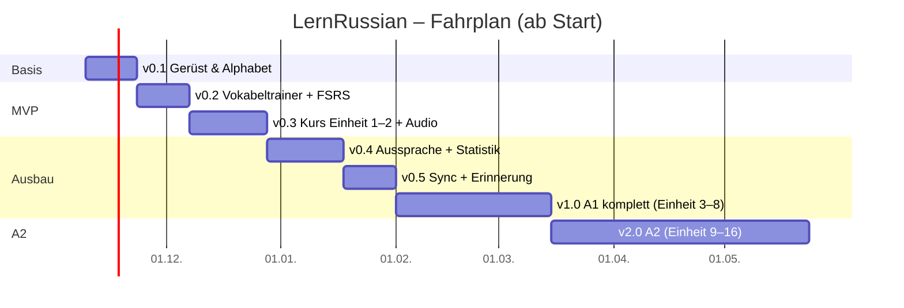

# 5. Zeitplan: MVP & Folgeversionen

## Stand (November 2026): alle geplanten Meilensteine umgesetzt

| Version | Inhalt | Status |
|---|---|---|
| v0.1 | Gerüst, PWA, Alphabet, Schreibübung, Tastatur | ✅ |
| v0.2 | Vokabeltrainer (FSRS), Themen, CSV | ✅ |
| v0.3 | Kurs-Engine, Dialog-Player, Übungen, Audio-Pipeline (Piper) | ✅ |
| v0.4 | Spracherkennung (Safari / Whisper), Aussprache-Trainer, Statistik | ✅ |
| v0.5 | Onboarding, Kalender-Erinnerung, Sync über GitHub Gist | ✅ |
| v1.0 | A1 komplett: Einheiten 1–8 | ✅ |
| v2.0 | A2 komplett: Einheiten 9–16 | ✅ |

**Bewusst noch offen** (mögliche nächste Schritte):
- Kyrillische **Schreibschrift** (пропи́си) als Zusatzmodul – bisher nur Druckschrift.
- **Lesetexte** mit Tipp-Übersetzung, B1-Inhalte.
- **Web Push**-Erinnerung (braucht einen kleinen Server, z. B. Cloudflare Worker) – derzeit Kalendertermin.
- Prüfung der Inhalte durch einen Muttersprachler.

---

Ursprünglicher Plan:

## Annahmen
- **Entwicklung:** Claude schreibt Code und Inhalte in Sessions; du testest auf dem iPhone und gibst Feedback.
- **Dein Aufwand:** ca. 3–5 Std./Woche für Testen, Feedback, Freigaben – plus deine eigene Lernzeit.
- Engpass ist nicht das Programmieren, sondern **Inhalte prüfen** und **auf dem echten Gerät testen** (Audio, Mikrofon, Offline-Verhalten in iOS).
- Ziel: **Du lernst so früh wie möglich mit der App** – die Inhalte wachsen schneller, als du sie durcharbeitest.

## Übersicht

## Meilensteine

### v0.1 – Gerüst & Alphabet (Woche 1–2)
- Projekt-Setup: Vite, React, TypeScript, Tailwind, PWA, Dexie, GitHub Actions → GitHub Pages
- App-Shell mit 5 Tabs, Dark Mode, Installation auf dem iPhone getestet
- Alphabet: 33 Buchstaben, 4 Lerngruppen, Audio pro Buchstabe + Beispielwort
- Schreibübung (Druckschrift, Nachzeichnen mit Vorlage)
- In-App-Tastatur (ЙЦУКЕН + phonetisch) + Tastatur-Trainer
- Offline-Grundfunktion
- ✅ **Ergebnis:** Du kannst ab Woche 2 das Alphabet lernen.

### v0.2 – Vokabeltrainer (Woche 3–4)
- FSRS-Karteikarten mit 4 Bewertungsstufen, Abfragemodi RU→DE, DE→RU (tippen), Hören
- 10 Themen-Sets à 20–40 Wörter mit Audio
- Eigene Sets, CSV-Import/-Export
- „Heute“-Screen mit fälligen Karten, Streak, Tagesziel
- Backup-Export/-Import (JSON)
- ✅ **Ergebnis:** Tägliche Vokabelroutine möglich → **MVP für den Alltag.**

### v0.3 – Kurs & Audio-Lektionen (Woche 5–7)
- Lektions-Runner (6 Schritte), Übungstypen: Auswahl, Zuordnen, Lückentext, Satzbau, Tippen, Diktat
- Audio-Player (Satz-Navigation, Wiederholen, Tempo, Shadowing, Sperrbildschirm)
- TTS-Pipeline (Silero/Piper) + Inhalte **Stufe 0 + Einheit 1–2** (10 Lektionen + 2 Checkpoints)
- Grammatik-Referenz zu den behandelten Themen
- „Alle Audios offline laden“
- ✅ **Ergebnis: MVP komplett** – Alphabet, Vokabeln, erste Lektionen, alles offline.

### v0.4 – Aussprache & Statistik (Woche 8–10)
- Spracherkennung (Web Speech API), Test als installierte iOS-App; Whisper-Fallback falls nötig
- Feedback-Regeln für typische Fehler Deutschsprachiger, A/B-Vergleich der Aufnahmen
- Lernzeit-Tracking, Diagramme (Lernzeit, Wortschatz, Heatmap, Genauigkeit)

### v0.5 – Sync & Erinnerung (Woche 11–12)
- Automatischer Sync über privates GitHub Gist (Offline-Warteschlange, Merge)
- Tägliche Erinnerung per Kalender (.ics); optional Web Push via Cloudflare Worker
- Onboarding (Lernziel, Tagesziel)

### v1.0 – A1 komplett (Woche 13–18)
- Einheiten 3–8 (30 Lektionen + 6 Checkpoints), ~650 Wörter, A1-Abschlusstest
- Lautschrift-Ausblendung nach Plan, Schwachstellen-Training („deine 20 schwierigsten Wörter“)
- Inhaltsprüfung: Validierungsskripte + Stichproben durch Muttersprachler

### v2.0 – A2 (Woche 19–28)
- Einheiten 9–16 (40 Lektionen + 8 Checkpoints), ~750 weitere Wörter
- Neue Übungstypen: Aspekt wählen, Deklinationstabellen, Leseverstehen mit kurzen Texten
- Kyrillische Schreibschrift (пропи́си) als Zusatzmodul

### Mögliche spätere Module (ohne festen Termin)
- Kurze Lesetexte & Geschichten mit Tipp-Übersetzung
- Übersetzungs-/Wörterbuch-Anbindung (z. B. Wiktionary, kostenlos)
- Native Hülle mit Capacitor (falls Apple-Developer-Account irgendwann vorhanden)
- B1-Inhalte

## Dein Lernplan parallel zur Entwicklung

| Zeitpunkt | App-Stand | Du lernst |
|---|---|---|
| Woche 2 | v0.1 | Alphabet, Lesen, Tippen |
| Woche 4 | v0.2 | + tägliche Vokabeln (Begrüßung, Zahlen) |
| Woche 7 | v0.3 | + Einheit 1–2 |
| Woche 18 | v1.0 | A1 läuft, du bist etwa bei Einheit 4–5 |
| ca. Monat 10–12 | v2.0 | A2 |

## Risiken & Gegenmaßnahmen

| Risiko | Gegenmaßnahme |
|---|---|
| Web Speech API funktioniert in installierter iOS-PWA nicht zuverlässig | Früher Gerätetest in v0.4, Whisper im Browser als Fallback |
| iOS löscht Offline-Daten | `storage.persist()`, Home-Screen-Installation, automatisches Backup/Sync |
| TTS-Betonung falsch | Betonte Schreibweise als TTS-Eingabe, Hörprüfung, Muttersprachler-Aufnahmen (Lingua Libre) für Kernwörter |
| Fehler in KI-generierten Inhalten | Validierungsskripte, Wiktionary-Abgleich, „Fehler melden“-Button, Tandem-Stichproben |
| Motivation sinkt nach 2–3 Monaten | Kurze Lektionen, sichtbarer Fortschritt, Kann-Sätze, Kalender-Erinnerung |
